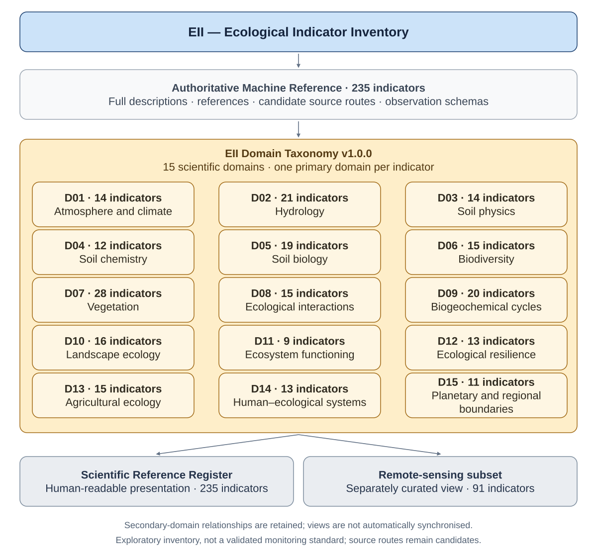

# EII — Research Protocol

**Document version:** 0.1.0 · Work in Progress — Academic Research Resource. This is the first separate protocol document, not a resource release or scientific verification.

## Current authority and interpretation rules

The [Machine Reference JSON](EII_Machine_Reference.json) is authoritative for structured records. The [Scientific Register](EII_Scientific_Reference_Register.md) and [README](README.md) are manually maintained human-readable presentations. [Remote Sensing](EII%20-%20Remote%20Sensing.md) is a separately curated analytical view. Legacy workbooks or source snapshots are evidence, not competing current authorities. The source repository retains authority; a website may later publish an explicitly approved pinned view. No automatic table generation or synchronisation is implemented.

Corpus means collected resources, indicator records, descriptions and provenance. Analysis is explicit examination or organisation of that corpus. Synthesis comprises arguments or propositions developed from evidence and analysis. Analytical prose may contain synthesis; file role does not itself establish verification status.

Retain all issued EII namespaced IDs exactly, one primary domain D01–D15, existing secondary domains, classification dimensions, family variants, canonical/display definitions, qualifications and original rows. Supporting-indicator relationships aid interpretation; they are not calculation dependencies. Measurements, derivations, proxies and inferences must remain distinguishable. Exploratory cross-domain combinations are not validated causal assertions.

GISDS routes remain candidates, not verified source-to-indicator or dataset bindings. No OSDS identifiers or unresolved IoT/bioinformatics namespaces are assigned. Null, absent fields, empty arrays and confirmed absence remain distinct. Do not invent reviewers, lifecycle events, observation bindings or bibliographic verification.

Current terminology is **Database Reference Methodology (DRM)**, developing shared conventions. Earlier **Database Research Methodology v1.0.0** references below describe historical source-edition intentions; approved conformance is not established. Future lifecycle, ingestion, storage, API and schema proposals are not recorded events or implemented services.

## Maintenance and validation

Review changes to structured records explicitly and update human presentations deliberately. Preserve source-edition snapshots and the [preservation crosswalk](EII_Preservation_Crosswalk.json); do not edit migration evidence as current research. Run `python3 scripts/validate_eii.py` after edits. Optional JSON Schema/CFF checks use installed validation dependencies. New evidence, taxonomy changes, identity resolution or authority transitions require separate research review. Website integration follows source review, commit and push; it is outside this restructuring.

## Version distinctions

README document 0.2.0 is its first explicit compact presentation version. Scientific Register 0.6.0 and Machine JSON 0.4.0 increment their existing minor versions for the new presentation/container. Remote Sensing 0.1.1 changes links only; the separate Research Protocol begins at 0.1.0. EII Domain Taxonomy v1.0.0 and existing record-schema claims remain unchanged. The minimal JSON serialization schema is `eii.machine-reference/0.1-draft`; it is not an ontology, ingestion implementation or approved DRM specification. No release, release date, DOI or licence is assigned.

## Historical source-edition methodology

The following labelled sections preserve prior rules, proposals and unresolved questions. Their file roles, status assertions, synchronisation claims, hashes, paths and version claims describe their original editions. The current authority and boundaries above govern this repository. No historical proposal has been activated by moving it here.


### Former README — Introduction

**Historical README edition; current authorities are defined in the Research Protocol.**

# EII — Ecological Indicator Inventory



*Existing EII taxonomy and document roles; source routes are candidates, not bound observations.* [View full-size diagram](assets/diagrams/eii_overview.svg).

**Work in Progress — Academic Research Resource**

Jonathan Minchin · Ecological Interaction · [ORCID 0000-0001-8152-1796](https://orcid.org/0000-0001-8152-1796).

EII is a higher-level reference for scientific and technological ecological indicators. Contributing catalogues describe observations, datasets, technologies or methods; EII describes measurements, qualified inferences and interpretive relationships. It is an exploratory research resource, not a validated monitoring standard.


### Former README — Start here

**Historical README edition; current authorities are defined in the Research Protocol.**

## Start here

- [Scientific Reference Register](EII_Scientific_Reference_Register.md): concise human-readable five-column catalogue, 235 indicators in the 15 scientific domains.
- [Machine Reference](EII_Machine_Reference.md): authoritative full-length structured records, source registries, scientific references, classifications, observation schemas, historical context and the domain-migration crosswalk.
- [Remote-sensing subset](EII%20-%20Remote%20Sensing.md): independently curated satellite/drone reading view with 91 indicators; aligned to the same domain taxonomy.
- [CITATION.cff](CITATION.cff): academic attribution.
- [CHANGELOG.md](CHANGELOG.md): development and publication preparation.


### Former README — Maintaining the files

**Historical README edition; current authorities are defined in the Research Protocol.**

## Maintaining the files

Maintain EII_Machine_Reference.md as the complete scientific record and EII_Scientific_Reference_Register.md as its concise five-column scientific presentation. Preserve the scientific table wording and identifiers during classification-only edits; do not replace the original scientific descriptions with display text. Full canonical/display descriptions remain in the machine records; the presentation is not an independent indicator inventory. The remote-sensing subset is a separately curated view and must be reviewed explicitly when its underlying records change. There is no automatic synchronization or database service.

Register records use fenced JSON inside Markdown. Existing fields and full descriptions are retained, with additive historical preservation fields. Do not recycle IDs, flatten family variants or treat supporting indicators as calculation inputs. Validate unique IDs, domain counts, source/reference keys, supporting relationships and presentation parity after edits. Historical source hashes describe reviewed editions, not current file contents.

The publication-facing methodology name is Database Reference Methodology (DRM), following the Ecological Information umbrella. The protected registers retain their historical methodology name and v1.0.0 reference. The umbrella currently supplies an introduction under development, not an approved detailed specification; conformance remains unverified. No new SQL database or invented external identifiers are introduced. GISDS routes remain candidate sources, AMRKB links remain technical context, and future IoT/bioinformatics bindings remain unassigned. Trails4Soil practice crosswalks are outside the active indicator scope but remain in the historical scientific register pending review. PBCKA/EIRKB interoperability remains outside the current scope.

The proposed website reading entry point is `EII_Scientific_Reference_Register.md`, with `EII_Machine_Reference.md` as its detailed structured reference. The previous EII.md / EII_Reference_Register.md names are historical file roles. Website integration, licensing and publication require separate review.


### Former README — Domain taxonomy and document versions

**Historical README edition; current authorities are defined in the Research Protocol.**

## Domain taxonomy and document versions

All three reference documents use **EII Domain Taxonomy v1.0.0** (D01–D15). Domain codes are stable and independent of sorting or ID prefixes. Each indicator has one primary domain; existing secondary domains remain in machine-record `related_domains`. The machine manifest preserves the 235-ID crosswalk from the scientific register's former A–P presentation groups. Historical source editions and file-role descriptions are retained as history, not current instructions.

| Document | Independent document version | Records |
|---|---|---:|
| Scientific Reference Register | 0.5.0 — 21 October 2026 | 235 |
| Machine Reference | 0.3.1 — 21 October 2026 | 235 |
| Remote Sensing | 0.1.0 — 21 October 2026 | 91 |

Document versions, EII Domain Taxonomy v1.0.0, the existing record schema and DRM v1.0.0 are independent references. No resource-release version is assigned by this migration. Database Reference Methodology compatibility is not certified: the available umbrella introduction is not a detailed specification.


### Former README — Register comparison and publication review

**Historical README edition; current authorities are defined in the Research Protocol.**

## Register comparison and publication review

The Scientific Reference Register and Machine Reference each contain 235 unique
indicator IDs with matching canonical names, acquisition-method fields and
primary assignments across D01–D15. The 91-indicator remote-sensing subset uses
matching primary assignments. The documents serve different purposes and
must not be treated as identical representations: the scientific catalogue
retains 120 earlier interpretation statements and 115 later display
inferences, while machine records preserve fuller canonical definitions,
measurements, inferences, classifications and relationships.

The Scientific Reference Register still contains internal discussion-derived
source labels and a historical Trails4Soil practice crosswalk explicitly
excluded from the active indicator inventory. Its historical proposals for
EIRKB mapping are also outside current interoperability scope. The Machine
Reference retains historical source paths, previous file roles, schemas and
provenance text. Those are archival evidence, not current paths or implemented
capabilities. Both registers are preserved unchanged; neutralising or separating
historical source material requires a specific research/publication decision.
The existing reference ranges, scientific wording and classifications are not
silently reconciled by this review.

### Database Reference Methodology alignment

This README uses **Database Reference Methodology (DRM)**, matching the
Information umbrella's `DRM/README.md`, which was read directly for this review.
This is terminology alignment only. The registers retain their historical
methodology wording and v1.0.0 reference, without any change to research methods,
classifications or version claims.

EII currently defines its own D01–D15 taxonomy, stable indicator IDs, record and
observation schemas, family variants, directed supporting-indicator relations,
source-route adapters and migration provenance. The umbrella introduction
sets out broader aims for portable classifications, shared identifiers and
explicit mappings, conceptual relationships and cross-database analytical
frameworks while preserving each database's own authority. It does not define
or validate EII's specific fields, relation vocabulary, mappings or schemas.

A federation-wide review must establish how EII's identifiers and classification
mappings relate to shared conventions, how candidate sources become evidenced
dataset bindings, and how analytical relations preserve evidence status and
project-specific exclusions. The historical v1.0.0 reference must also be
reconciled with the umbrella's unversioned introduction. No conflict is silently
resolved, and no methodological conformance is certified by this edit.

### Historical scope review: Trails4Soil

The historical material remains in the current Scientific Reference Register
pending a future scope revision. Its introduction (line 22), Section 4
(lines 416–443, 21 provisional practice rows), Section 7 source entry
`FRAME-T4S` (line 498), and v0.1.0 history (line 513) require review together.
These are historical management-practice mappings, not 21 additional measured
indicators. Their retention does not complete a scope revision or establish
programme verification. No indicator has been removed, reclassified, merged or
relocated.

The 21 rows reference the existing indicator families below; ranges expand
only for audit identification and do not introduce or renumber records:

- BIO-001, BIO-004, BIO-005, BIO-007, BIO-008, BIO-009.
- DIS-010.
- FUN-003, FUN-004, FUN-005, FUN-006, FUN-007, FUN-008, FUN-013.
- HYD-001.
- MIC-001, MIC-002, MIC-003, MIC-004, MIC-005, MIC-006, MIC-007, MIC-008, MIC-009, MIC-010, MIC-011, MIC-012, MIC-013, MIC-014, MIC-015, MIC-016, MIC-019, MIC-020, MIC-021, MIC-023, MIC-024.
- SOI-002, SOI-003, SOI-005, SOI-008, SOI-010, SOI-011, SOI-012.
- TER-013.
- VEG-001, VEG-012, VEG-017.

Row 21 also uses the unspecific phrase “MIC profiles as optional model input”.
It cannot be assigned a precise indicator ID without a research decision.
Review it rather than inferring an identifier. The machine register's statements
excluding the crosswalk from active scope remain intact.

### Historical provenance requiring research review

The Scientific Reference Register Section 7 retains four internal development
source labels at lines 488–491. They are not scholarly bibliographic identifiers;
they require an explicit provenance mapping or neutral-wording revision in a
future authorised register edit. Its introductory wording (lines 20 and 22),
Section 4 provenance (line 420), Section 7 introduction (line 484), and v0.1.0
history (line 513) likewise remain unchanged. `FRAME-T4S` is a provisional
programme-source label, not a verified scholarly citation, and is preserved.
Scholarly/local reference keys such as R01–R12, provider IDs RS001–RS025,
indicator IDs and DOI/URL references must not be mistaken for internal
conversation metadata.

The Machine Reference's historical `source_context` retains the named earlier
scope source at line 19107 (`inventory_v0_2_0_introduction`) and local source paths
at lines 19108 and 19111 (`inventory_v0_2_0_appendices` and
`machine_readme_v0_2_1`). Those paths and source hashes are historical provenance,
not current access routes. The generic `inventory.json` derivation artifact is
not present locally; its identity cannot be reconstructed from its filename
alone. Historical source editions, checksums and all protected bytes remain
preserved for a future review. Line references identify this audited edition
and may change in later revisions.


### Scientific Register 0.5.0 introduction (historical)

# EII — Ecological Indicator Inventory

**Status:** Living reference · Stage A (inventory)  
**Source document version:** 0.1.0  
**Created:** 2026-10-10  
**Project:** Ecological Indicator Inventory (EII) — independent of EIRKB, designed for later interoperability  
**Scope:** Landscape, GIS/remote sensing, point clouds, soil, microbiomes, ecological processes, and socio-ecological context.


**Consolidated document version:** 0.5.0 · Local review draft · 21 October 2026  
**Work in Progress — Academic Research Resource**  
Jonathan Minchin · Ecological Interaction · [ORCID 0000-0001-8152-1796](https://orcid.org/0000-0001-8152-1796).

**Edition note:** The original v0.1.0 scientific wording, five-column table format and 120 indicator rows are preserved, together with all 115 later indicator rows. This edition reorganises the 235 records into EII Domain Taxonomy v1.0.0 (D01–D15), using the established machine-record assignments. Historical A–P presentation groups are retained in the migration crosswalk in EII_Machine_Reference.md. The original source-version/date fields refer to the source edition; ID prefixes do not replace domain membership.

The complete definitions, measurements, formulas, interpretation limits, supporting indicators, classifications, scientific references and candidate source routes remain in [EII_Machine_Reference.md](EII_Machine_Reference.md). Original wording is retained as historical wording where later source editions qualify it; it is not newly validated. Historical proposals for EIRKB mapping below remain source-edition proposals and are outside current EII interoperability scope. Future IoT and bioinformatics routes remain unassigned. DRM v1.0.0 is the intended methodology; conformance remains unverified.


### Scientific Register — purpose and boundaries (historical wording)

## 1. Purpose and boundaries

EII is a **parallel, standalone inventory** of ecological variables, indicators, indices, and inferences. It consolidates the earlier GIS/remote-sensing and bioinformatics discussions into one growing, human-readable Markdown reference. It is **not yet** a validated indicator standard, a database, or an EIRKB module. Scientific verification, bibliographic enrichment, and database implementation belong to later stages.

**Important distinction:** The previously discussed **21 TRAILS4SOIL items are regenerative management practices**, not 21 verified ecological indicators. Their mappings below are exploratory, not an official programme indicator framework.


### Scientific Register 0.5.0 — 6. Proposed record schema for later interoperability

## 6. Proposed record schema for later interoperability

EII stays in Markdown for now. Each record could later be normalised into CSV/SQLite/JSON-LD with these fields:

| Field | Purpose |
|---|---|
| `eii_id` | Stable namespaced identifier (`EII:MIC-010`) |
| `preferred_label` / `aliases` | Human-readable name and synonyms |
| `entity_kind` | Variable, index, proxy, inference, contextual factor |
| `domain` / `related_domains` | Primary and secondary categories |
| `definition` | Operational definition and limitations |
| `unit` / `formula` | Unit and computation where applicable |
| `observed_property` | What the measurement actually records |
| `methods` / `platforms` | Sampling, instruments, processing pipelines |
| `spatial_scale` / `temporal_scale` | Resolution and applicable time horizon |
| `data_requirements` | Input bands, samples, reference datasets |
| `uncertainty` / `validation` | Error sources and ground-truth requirements |
| `reference_ids` | Bibliographic cross-references; later EIRKB mapping |
| `dataset_ids` / `place_ids` | External dataset and geospatial references |
| `related_eii_ids` | Dependencies, derived products and links |
| `provenance` / `review_status` | Source and evidence status |

**Interoperability principle:** Do not duplicate the EIRKB bibliographic catalogue. Later use explicit mappings from `EII:*` to EIRKB reference identifiers, Zotero keys/DOIs, and GIS-compatible dataset/feature IDs. No live EIRKB link is implied at this stage.


### Scientific Register 0.5.0 — 8. Editorial rules and roadmap

## 8. Editorial rules and roadmap

1. **Stage A — Inventory (current):** Expand coverage, de-duplicate synonyms, separate indicators from methods, pressures and practices; retain stable IDs.
2. **Stage B — Scientific definitions:** Add formulas, units, sampling protocols, scale, reference standards, DOI/Zotero references, validation and evidence grading.
3. **Stage C — Relationships and inference:** Link observation → measurement → index → ecological process → interpretation, marking inferential confidence.
4. **Stage D — Place-based applications:** Add location-specific applicability, GIS layers, climate analogues and intervention use cases.

### Known gaps for subsequent Stage A expansions

Freshwater ecology and aquatic eDNA; marine/coastal indicators; soil fauna and nematodes; animal behaviour and movement; ecosystem services; atmospheric pollutants; geochemistry and geological substrates; disease ecology; socio-ecological governance; environmental justice; explicit biogeochemical fluxes; conservation status; ecological network metrics; regional and planetary boundaries; cross-scale temporal indicators.


### Historical Inventory v0.2.0 introduction — Introduction

**Historical Inventory v0.2.0 introduction; original research status and qualifications retained.**

# EII — Ecological Indicator Inventory

**Master inventory · Version 0.2.0 · 13 October 2026**  
**Scope:** Scientific and technological ecological variables, derived indicators, process measurements, pressures and explicitly qualified inferences.  
**Coverage:** 235 records across the original 15 domains; all 120 v0.1.0 IDs retained.  
**Status:** Extended Stage A inventory with operational working definitions. This is a research reference, not a validated monitoring standard or an exhaustive list of every possible indicator.


### Historical Inventory v0.2.0 introduction — Purpose and reviewed source baseline

**Historical Inventory v0.2.0 introduction; original research status and qualifications retained.**

## Purpose and reviewed source baseline

EII is the higher-level indicator reference: contributing catalogues describe data, technologies, methods or management context; EII describes what an indicator represents, how it is obtained, what conclusions it supports and which other indicators help interpret it. One indicator can have multiple acquisition routes without becoming multiple ecological concepts.

Reviewed local documents:

- `EII/EII.md`, v0.1.0, created 10 October 2026: 120 records in eight legacy groups, plus the earlier 15-domain scope from **EII Overview**.
- `GISDS/Cartography_Database_Sources.md`, v1.0, updated 12 October 2026, and its README: 22 stable catalogue IDs, `RS001`–`RS022`. These are mainly platforms/catalogue resources, not bound dataset records.
- `AMRKB/README.md`, v0.1.0, created 12 October 2026: scope and proposed architecture only. No implemented observation database, record IDs or agricultural dataset register was found.

Appendix provenance hashes identify the reviewed source files.

**Exclusions:** The Trails4Soil practice list and programme crosswalk are omitted entirely. No interoperability edge or bibliography dependency to PBCKA or EIRKB is created. AMRKB references are limited to empirically assessable technical methods, inputs and management context; philosophical, cultural and historical classifications are outside this inventory. Existing quantitative human-pressure indicators remain in Domain 14.


### Historical Inventory v0.2.0 introduction — Reading and interpretation rules

**Historical Inventory v0.2.0 introduction; original research status and qualifications retained.**

## Reading and interpretation rules

Each entry has a definition, actual observations/calculation and units, a defensible inference with limits, and supporting EII IDs. A derived index measures its mathematical input contrast; an inference about physiology or ecosystem condition requires validation. Method choice can change whether a quantity is measured or modelled. DNA potential, RNA expression, protein detection, enzyme assays and realised process fluxes are distinct evidence layers.

Supporting indicators are **interpretive companions**, not automatically formula inputs, causal evidence or substitutes. Relations are directed recommendations and need not be reciprocal. Use the relevant component of a family record. Multiple observations strengthen an inference only when their methods, spatial support, timing and uncertainty are compatible.

No universal “higher is better” direction is assigned: high respiration, nutrient concentration, greenness or diversity can have different implications by ecosystem and context. Management-effect claims require controls, replication and attention to confounding. Composite scores must retain their components, weights, reference conditions and uncertainty.

### Stable IDs and compound records

Legacy local IDs and preferred labels are retained exactly; their namespaces are now explicit, e.g. `EII:VEG-001`. IDs do not encode the current domain: moving a record never renumbers it. New records use new unused IDs. IDs are never recycled; future merges/deprecations should retain an alias/redirect and a versioned reason.

Several legacy labels combine distinct variables. They remain **family records**, with machine-readable `variants` in their metadata. An observation must select a variant (e.g. `EII:SOI-005` plus `organic_C_stock` versus `organic_C_concentration`) and record method and unit. Never place pH, salinity, carbon stocks, concentrations, GPP and NPP into one interchangeable numeric series. Existing separate additions such as `ATM-001`/`ATM-002` can specialise `DIS-006`; they do not retire its family ID. Family member keys are stable within their EII ID.

### Four classification levels

| Level | Field | Meaning |
|---|---|---|
| Primary | `domain` | One of the original 15 domains; one home per record, with optional `related_domains`. |
| Secondary | `secondary` | Acquisition/epistemic type: `observed`, `measured`, `derived`, `proxy`, `inferred`, `modelled`, `composite`, `predictive`, `process`, `context`, `pressure`. Tags can coexist and are method-dependent. |
| Tertiary | `tertiary.spatial`, `tertiary.temporal` | Typical observation/application supports and intervals. These are applicability guides, never claims of native pixel resolution, minimum sampling frequency or validated extrapolation. |
| Quaternary | `quaternary` | Ecological/assessment role: state, condition, function, pressure, context, exposure, disturbance response, production assessment, restoration assessment, planning or threshold comparison. |

A molecular/sample profile remains a sample observation when mapped: interpolation to a landscape requires a separate model, validation and uncertainty. Station records, pixels, field plots and watersheds cannot be combined simply because their coordinates overlap. Aggregate by an explicit support/time transformation; do not silently resample into apparent precision.

### Compact interoperability

Each heading has a stable HTML anchor. Immediately below it is an HTML comment containing one JSON object prefixed by `eii:`. Comments remain unobtrusive in rendered Markdown and can be parsed from the raw download. Definition/direct/inference/support bullets have fixed labels. The JSON fields use full names; `routes` contains short **EII-local adapter keys**, resolved once in Appendix A. These keys are not IDs invented for other projects.

`GISDS:RS001` and similar source-system IDs preserve the existing catalogue IDs. A route is a **candidate** until an exact dataset/product/version is bound. Not every indicator can be derived from every source listed in a route: band coverage, geography, calibration and validation decide suitability. Provider/model estimates require their own methods and quality metadata.

AMRKB links express context or possible technical-method relationships, never claimed observed data provenance. IoT/bioinformatics routes have `namespace: null` and `dataset_id: null`: they are reserved integration channels, not existing databases. Scientific references in Appendix B are local EII bibliography keys, independent of the excluded knowledge bases. Acquisition possibilities and documentary references must never be confused with proof that an indicator has actually been computed.


### Historical Inventory v0.2.0 introduction — Domain index

**Historical Inventory v0.2.0 introduction; original research status and qualifications retained.**

## Domain index

| Domain | Scope | Records |
|---|---|---:|
| D01 | [Atmosphere and climate](EII_Scientific_Reference_Register.md#d01) | 14 |
| D02 | [Hydrology](EII_Scientific_Reference_Register.md#d02) | 21 |
| D03 | [Soil physics](EII_Scientific_Reference_Register.md#d03) | 14 |
| D04 | [Soil chemistry](EII_Scientific_Reference_Register.md#d04) | 12 |
| D05 | [Soil biology](EII_Scientific_Reference_Register.md#d05) | 19 |
| D06 | [Biodiversity](EII_Scientific_Reference_Register.md#d06) | 15 |
| D07 | [Vegetation](EII_Scientific_Reference_Register.md#d07) | 28 |
| D08 | [Ecological interactions](EII_Scientific_Reference_Register.md#d08) | 15 |
| D09 | [Biogeochemical cycles](EII_Scientific_Reference_Register.md#d09) | 20 |
| D10 | [Landscape ecology](EII_Scientific_Reference_Register.md#d10) | 16 |
| D11 | [Ecosystem functioning](EII_Scientific_Reference_Register.md#d11) | 9 |
| D12 | [Ecological resilience](EII_Scientific_Reference_Register.md#d12) | 13 |
| D13 | [Agricultural ecology](EII_Scientific_Reference_Register.md#d13) | 15 |
| D14 | [Human–ecological systems](EII_Scientific_Reference_Register.md#d14) | 13 |
| D15 | [Planetary and regional boundaries](EII_Scientific_Reference_Register.md#d15) | 11 |


### Historical Inventory v0.2.0 appendices — Appendix A — Source routes and interoperable observation schema

**Historical Inventory v0.2.0 appendices; original research status and qualifications retained.**

## Appendix A — Source routes and interoperable observation schema

The following registry is machine-readable. It stores **route-level possibilities**, not completed dataset links. The GISDS register remains authoritative for provider names/access/coverage/licences. Computation/viewing services `RS020` and `RS022`, AI summaries `RS008`, and general discovery resources do not supply ecological observations merely by displaying or processing them. They can later be recorded as `processed_by` or discovery context, never substituted for original data provenance. Only relevant existing RS IDs are used below; unused catalogue IDs remain intact in GISDS.

Bind only the selected source(s) and product(s), not every candidate in a route. Unbound indicators with `routes: []` require an independently registered field/laboratory/model dataset or a future contributing catalogue. Empty routes mean “no suitable specific route established from reviewed catalogues”, not “no scientific acquisition method exists”. Even records with candidate routes commonly require complementary field or laboratory observations beyond GISDS.

```json
{
  "schema_version": "eii.inventory/1.0",
  "document_version": "0.2.0",
  "date": "2026-10-13",
  "namespace": "EII",
  "record_count": 235,
  "source_routes": {
    "opt": {
      "namespace": "GISDS",
      "external_ids": [
        "RS001",
        "RS002"
      ],
      "role": "candidate_input",
      "input": "Product-specific calibrated optical reflectance with suitable bands",
      "dataset_id": null,
      "status": "candidate_unbound"
    },
    "rededge": {
      "namespace": "GISDS",
      "external_ids": [
        "RS001"
      ],
      "role": "candidate_input",
      "input": "Selected Sentinel-2 red-edge/NIR bands with recorded wavelengths and matched spatial support",
      "dataset_id": null,
      "status": "candidate_unbound"
    },
    "rgb": {
      "namespace": "GISDS",
      "external_ids": [
        "RS021"
      ],
      "role": "candidate_input",
      "input": "Selected orthophoto with calibrated RGB; own cameras require separate acquisition records",
      "dataset_id": null,
      "status": "candidate_unbound"
    },
    "veg": {
      "namespace": "GISDS",
      "external_ids": [
        "RS004",
        "RS001",
        "RS002"
      ],
      "role": "candidate_input",
      "input": "Selected vegetation product or suitable reflectance; field validation required",
      "dataset_id": null,
      "status": "candidate_unbound"
    },
    "terrain": {
      "namespace": "GISDS",
      "external_ids": [
        "RS021"
      ],
      "role": "candidate_input",
      "input": "Selected DTM/LiDAR/orthophoto product; local field surveys remain separate",
      "dataset_id": null,
      "status": "candidate_unbound"
    },
    "thermal": {
      "namespace": "GISDS",
      "external_ids": [
        "RS002"
      ],
      "role": "candidate_input",
      "input": "Selected Landsat thermal product; local canopy thermography is a separate acquisition",
      "dataset_id": null,
      "status": "candidate_unbound"
    },
    "sar": {
      "namespace": "GISDS",
      "external_ids": [
        "RS001"
      ],
      "role": "candidate_input",
      "input": "Selected Sentinel radar product with declared processing",
      "dataset_id": null,
      "status": "candidate_unbound"
    },
    "land": {
      "namespace": "GISDS",
      "external_ids": [
        "RS004",
        "RS005",
        "RS006",
        "RS009"
      ],
      "role": "candidate_input",
      "input": "One or more geographically suitable land-classification products; harmonise taxonomy and versions",
      "dataset_id": null,
      "status": "candidate_unbound"
    },
    "water": {
      "namespace": "GISDS",
      "external_ids": [
        "RS013"
      ],
      "role": "candidate_input",
      "input": "Selected surface-water occurrence/seasonality product; not discharge observations",
      "dataset_id": null,
      "status": "candidate_unbound"
    },
    "flood": {
      "namespace": "GISDS",
      "external_ids": [
        "RS014"
      ],
      "role": "candidate_input",
      "input": "Selected observed inundation product; keep forecasts separate",
      "dataset_id": null,
      "status": "candidate_unbound"
    },
    "drought": {
      "namespace": "GISDS",
      "external_ids": [
        "RS015"
      ],
      "role": "candidate_input",
      "input": "Selected drought indicator and its underlying variable/method; not a universal moisture or future-climate source",
      "dataset_id": null,
      "status": "candidate_unbound"
    },
    "fire": {
      "namespace": "GISDS",
      "external_ids": [
        "RS016",
        "RS017"
      ],
      "role": "candidate_input",
      "input": "Selected event/burn-area/thermal-detection product with product-specific semantics",
      "dataset_id": null,
      "status": "candidate_unbound"
    },
    "marine": {
      "namespace": "GISDS",
      "external_ids": [
        "RS018"
      ],
      "role": "candidate_input",
      "input": "Selected marine variable, distinguishing observation from model and surface from depth",
      "dataset_id": null,
      "status": "candidate_unbound"
    },
    "settlement": {
      "namespace": "GISDS",
      "external_ids": [
        "RS019"
      ],
      "role": "candidate_input",
      "input": "Selected built-up/settlement product; roads and engineering detail need independent datasets",
      "dataset_id": null,
      "status": "candidate_unbound"
    },
    "reef": {
      "namespace": "GISDS",
      "external_ids": [
        "RS012"
      ],
      "role": "candidate_context",
      "input": "Mapped reef habitat; live coral/bleaching outcomes require field or specialised observations",
      "dataset_id": null,
      "status": "candidate_unbound"
    },
    "mangrove": {
      "namespace": "GISDS",
      "external_ids": [
        "RS011"
      ],
      "role": "candidate_input",
      "input": "Mangrove extent/change; condition requires additional observations",
      "dataset_id": null,
      "status": "candidate_unbound"
    },
    "amr": {
      "namespace": "AMRKB",
      "external_ids": [],
      "document": "README.md",
      "version": "0.1.0",
      "role": "method_or_management_context",
      "input": "Scientific/technical practices, input records and experimental context only; no observation dataset reviewed",
      "dataset_id": null,
      "status": "scope_only"
    },
    "iot": {
      "namespace": null,
      "planned_channel": "iot",
      "external_ids": [],
      "role": "future_input",
      "input": "Future calibrated, georeferenced sensor streams; project namespace and dataset IDs not assigned",
      "dataset_id": null,
      "status": "unresolved_future"
    },
    "bio": {
      "namespace": null,
      "planned_channel": "bioinformatics",
      "external_ids": [],
      "role": "future_input",
      "input": "Future biological observations and pipeline outputs; local project namespace and accessions not assigned",
      "dataset_id": null,
      "status": "unresolved_future"
    }
  },
  "provenance": [
    {
      "path": "/Users/jonathan/Github/ecological-information/EII/EII.md",
      "sha256": "47f7098f999cbb2570464d198793a11b0624386ee9b43fad0a2e9edd3451d547"
    },
    {
      "path": "/Users/jonathan/Github/ecological-information/EII/README.md",
      "sha256": "41429e550fc7fb4ccc313543f320a8e14df49bfcab5881e7137061ebf0bb0d92"
    },
    {
      "path": "/Users/jonathan/Github/ecological-information/GISDS/Cartography_Database_Sources.md",
      "sha256": "82cec11c4eb6706ac200db2986631c3e25831ae6424f3b955e4bcfa0813ec1b8"
    },
    {
      "path": "/Users/jonathan/Github/ecological-information/GISDS/README.md",
      "sha256": "84b225b53b0999c4d46144e7436f93560ddbf29d79e587ad7bbd38e9f2ab3a8c"
    },
    {
      "path": "/Users/jonathan/Github/ecological-information/AMRKB/README.md",
      "sha256": "4eb11eb8f9ead8d907007dc26d0c469d8dda78b1d250b9dab1b9205d10708ea1"
    }
  ]
}
```

### Binding observations without inflating the inventory

Keep actual measurements in contributing datasets. A future binding/observation record should include:

```json
{
  "eii_id": "EII:SOI-005",
  "variant": "organic_C_stock",
  "observation_id": null,
  "binding_status": "unbound",
  "source_namespace": null,
  "source_record_id": null,
  "dataset_id": null,
  "dataset_version": null,
  "relation": "derived_from",
  "method_id": null,
  "method_version": null,
  "observed_property": "soil organic carbon stock in a declared layer",
  "value": null,
  "unit": "Mg C/ha",
  "location_id": null,
  "geometry": null,
  "crs": null,
  "spatial_support": null,
  "depth_interval_cm": null,
  "time_start": null,
  "time_end": null,
  "input_observation_ids": [],
  "processing": null,
  "calibration": null,
  "uncertainty": null,
  "quality_flags": [],
  "detection_limit": null,
  "licence": null,
  "attribution": null,
  "retrieved_at": null
}
```

This is an unfilled schema example, not an actual measurement. `null` means unknown/unbound, never zero; missing values and non-detects must remain distinguishable. Use ISO 8601 timestamps with timezone, explicit dry/wet and element/compound mass bases, documented units and named uncertainty models. Add sensors/calibration/drift/gaps for IoT; add sample/depth/accessions, extraction/primers, controls, library size, normalisation, annotation/reference versions and pipeline version for bioinformatics. Store exact dataset URLs and product-specific rights at binding time.

Relations are controlled: `observed_in`, `derived_from`, `estimated_by`, `contextualised_by`, `processed_by`, `supported_by`. Source routes above remain candidates; AMRKB should normally bind as `contextualised_by` or a separately identified technical method, not `observed_in`, until actual observations exist. A future dataset's namespace must be registered deliberately, rather than inferring a new database identity from the labels “IoT” or “bioinformatics”.

For actual computational dependencies, store `input_observation_ids` and the formula/pipeline independently of the inventory's interpretive `support`. A field-validated NDVI biomass model should bind both reflectance and calibration observations and declare an `estimated_by` relation; it must not relabel NDVI itself as measured biomass.

### SOC stock calculation example

Using organic C concentration in g/kg, compatible fine-earth bulk density in g/cm³, layer thickness in cm and coarse-fragment volume fraction, a commonly used stock form is:

`SOC stock (Mg C/ha) = C (g/kg) × BD_fine (g/cm³) × thickness (cm) × (1 − coarse_fragment_volume_fraction) × 0.1`.

The density denominator and fragment correction must match: do not apply the correction twice if density already expresses dry fine-earth mass per total sample volume. Sum declared layers; use consistent/equivalent soil mass for repeated comparisons where density changes. Concentration, stock and stock-change rate remain separate variants/records. [FAO Annex 4](https://www.fao.org/fileadmin/user_upload/GSP/MRV/GSP_MRV_Protocol_A4_EN_002.pdf).


### Historical Inventory v0.2.0 appendices — Maintenance, validation and next review

**Historical Inventory v0.2.0 appendices; original research status and qualifications retained.**

## Maintenance, validation and next review

New IDs are assigned once; edits preserve identity unless a concept changes enough to require a new record and explicit relation. Definitions and formulas must cite the selected convention; variant additions must not change old series meaning. New dataset links need actual source-system IDs and a resolved binding. Add new contributing scientific/technological catalogues to the route registry without duplicating their authoritative records or introducing excluded-project dependencies.

Before using an indicator operationally: select the variant and assay/product; confirm units and method version; validate context-specific inference; record uncertainty, spatial/temporal support and sampling design. For modelled/composite/predictive outputs, keep inputs, weights, baseline, validation and scenario explicit. Verify specialist entries against primary protocols during Stage B, prioritising molecular functions, composite indices, remote trait retrievals and threshold comparisons.

[Source-edition version history](CHANGELOG.md#relocated-historical-version-history).

### Historical Register pair v0.2.1 introduction — Introduction

**Historical Register pair v0.2.1 introduction; original research status and qualifications retained.**

# EII — Ecological Indicator Reference Register

A reference to scientific and technological indicators of ecological condition, processes and environmental pressures. The register explains what each indicator represents, what is observed or calculated, which inferences it can support, and which other indicators help interpret it.


### Historical Register pair v0.2.1 introduction — Reading the tables

**Historical Register pair v0.2.1 introduction; original research status and qualifications retained.**

## Reading the tables

Each row names an indicator, explains how and where it is measured, and gives a short explanation of what it can tell us. Supporting indicators are clickable names for other measurements that help interpret the result.

RS source references point to the source register below. IoT means connected environmental sensors; “future” means that the contributing dataset catalogue has not yet been connected. Source pointers are possibilities, so the exact dataset or field method still needs checking.


### Historical Register pair v0.2.1 machine guidance — Introduction

**Historical Register pair v0.2.1 machine guidance; original research status and qualifications retained.**

# EII reference register — machine README

**Work in Progress — Academic Research Resource**

Author: Jonathan Minchin · Ecological Interaction · [ORCID 0000-0001-8152-1796](https://orcid.org/0000-0001-8152-1796).

Start with the [Ecological Indicator Reference Register](EII_Scientific_Reference_Register.md). The [remote-sensing subset](EII%20-%20Remote%20Sensing.md) provides a focused reading view; [EII.md](EII_Scientific_Reference_Register.md) preserves the extended inventory baseline. Citation metadata is in [CITATION.cff](CITATION.cff), and publication preparation is recorded in [CHANGELOG.md](CHANGELOG.md).


### Historical Register pair v0.2.1 machine guidance — Two maintained files

**Historical Register pair v0.2.1 machine guidance; original research status and qualifications retained.**

## Two maintained files

- `EII_Reference_Register.md`: the human-readable scientific register. Its tables contain all 235 indicators, the original 15 domains, direct measurements/calculations, inference limits, supporting indicators, classifications, methods, concise source pointers and scientific references.
- `README.md`: administrative history, update workflow, interoperability rules, schema, baseline provenance and a complete machine-readable snapshot. This is the technical companion, not an additional indicator inventory.

Both files are intended to be maintained together. There is no automatic synchronization with repository EII.md, GISDS, AMRKB or remote services. The working pair is installed in the EII repository folder. `EII_Reference_Register.md` is the human reading interface and this `README.md` is its machine-oriented companion. The existing `EII.md` remains the earlier inventory baseline; future register work should maintain the two files named above together.


### Historical Register pair v0.2.1 machine guidance — Update workflow

**Historical Register pair v0.2.1 machine guidance; original research status and qualifications retained.**

## Update workflow

1. Read both files and identify the affected stable EII IDs. Treat human table content as the editorial interface for labels, definitions, measurements and inferences; treat this README as the operational metadata and synchronization companion.
2. Edit the scientific row and any associated classification, family description, source or reference row. Keep definitions, measurements, potential functions and realised process rates distinct. Preserve original labels/IDs unless an explicitly justified scientific correction is recorded here.
3. Update the matching JSON record below in the same change. Human field mapping: the hidden stable anchor identifies `id`; indicator name → `display_label`; measurement/source text → `display_measurement`, `measurement_origin` and canonical `direct`; beginner inference → `display_inference`; named supporting links → `support`; concise sources → `display_source_refs` and resolved `routes`. Keep canonical `label`, `definition` and detailed `inference` alongside the beginner fields; do not silently discard their scientific distinctions. There is no visible kind/method code column.
4. For an operational-metadata change, update this README and refresh any affected human source pointer, classification or quantity distinction. Do not expand human rows with acquisition schemas, raw accessions, large JSON or administrative notes.
5. If either file has diverged, compare values by stable ID and reconcile both explicitly. Do not silently regenerate one from a stale snapshot. The machine snapshot is synchronized data, not permission to overwrite later human edits.
6. New records receive an unused ID, one home domain, non-empty definition/direct/inference fields, and appropriate classifications. IDs are never recycled or renumbered when domains change. Retain a redirect/versioned reason if a concept is merged or retired.
7. Validate the pair: unique IDs; all original 120 IDs/labels preserved unless an explicit correction is recorded; 15 domains; support links and anchors resolve; route/ref keys resolve; no excluded interoperability edges; family quantities remain separate; complete matching row/record sets.
8. Record the substantive update and evidence-review scope here. Refresh the human-file SHA-256 in the manifest after saving. Keep source-review hashes labelled as baseline provenance, rather than treating them as current remote or repository state.


### Historical Register pair v0.2.1 machine guidance — Scope and scientific review state

**Historical Register pair v0.2.1 machine guidance; original research status and qualifications retained.**

## Scope and scientific review state

Only scientific/technological indicators and empirically describable pressures/context are in scope. Exclude the Trails4Soil practice list/crosswalk and all interoperability dependencies to PBCKA or EIRKB. AMRKB can provide technical agricultural methods and management context, not philosophical/cultural classification. Quantitative resource flows and human environmental pressures remain in Domain 14.

All records are curated working definitions. `refs` indicates a documentary source for a specific aspect, not full local validation or certification. `review_scope: specific_documentary_aspects_only` must not be upgraded to a verified standard without a protocol-level review. Framework references do not assert a formal EBV/ECV/SEEA crosswalk. The planetary-boundary source is a versioned framework reference, not a current transgression count or automatic local threshold allocation.

Supporting indicators are directed interpretive recommendations, not necessarily calculation dependencies or causal evidence. `input_observation_ids` belongs to actual computations and must be stored separately from `support`. Increased greenness, diversity, respiration or composite score is not universally a beneficial outcome. Composite/predictive/modelled records require declared inputs, conventions, baselines, uncertainty and validation.


### Historical Register pair v0.2.1 machine guidance — Identifier and field contract

**Historical Register pair v0.2.1 machine guidance; original research status and qualifications retained.**

## Identifier and field contract

- `id`: full stable identifier `EII:VEG-001`; its short form is now visible beside the indicator name, and its lowercase form remains the stable link anchor. There is no separate ID column. Prefix does not encode current domain.
- `label`, `definition`, `direct`, `inference`: preserved detailed scientific layer from the extended inventory. Human names, measurements and inferences have their own display fields; definitions are retained here rather than appended to indicator names.
- `domain`: D01–D15, one home domain. `related_domains`: optional cross-domain associations without record duplication.
- `secondary`: evidence/acquisition tags (`observed`, `measured`, `derived`, `proxy`, `inferred`, `modelled`, `composite`, `predictive`, `process`, `context`, `pressure`).
- `tertiary.spatial` / `tertiary.temporal`: typical applicability, not native resolution or validated extrapolation.
- `quaternary`: ecological/assessment role; provisional and method-dependent.
- `support`: full EII IDs for interpretive companion indicators.
- `routes`: EII-local route keys resolved in the manifest; these are not invented source-system records.
- `refs`: local EII scientific reference keys R01–R12, resolved to title/URL/scope in the manifest and human reference table.
- `record_type`: `indicator` or `family`. `variants`: stable quantity keys under a family ID. Observations of families must identify the selected variant.
- `status`, `review_scope`, `legacy`: review/migration metadata retained here rather than in reader-facing rows.
- `display_label`: short human-readable indicator name, which may differ from the preserved canonical label.
- `measurement_origin`, `display_measurement`: plain acquisition source and reader-facing measurement text; source describes satellite, sensor, field, laboratory, records or model as appropriate.
- `display_inference`: beginner-facing explanation with essential limitations retained; canonical `inference` preserves fuller scientific detail.
- `display_source_refs`: concise source pointers without dagger markers.
- `display_kind`: null because the coded column is removed. `display_methods` retains the former acquisition codes for audit/migration only; it is not shown as a main-table column.


### Historical Register pair v0.2.1 machine guidance — Interoperability and unresolved routes

**Historical Register pair v0.2.1 machine guidance; original research status and qualifications retained.**

## Interoperability and unresolved routes

Existing GISDS catalogue IDs RS001–RS022 remain authoritative in GISDS; only relevant reviewed IDs are referenced here. A platform/resource is not a dataset. Route links are candidates until exact product, dataset, release, location/date, processing, licence and calibration are bound. Not every hosted product is suitable for every indicator. Red-edge retrieval requires the appropriate bands; thermal estimates require thermal observations; ground models differ from canopy surface models.

AMRKB v0.1.0 is a scope/architecture document with no implemented record IDs or observation database found. Its routes express technical method/management context, not data provenance. Future IoT and bioinformatics channels have null namespaces and null dataset IDs; no existing database identity, accession or sensor stream is implied. Discovery tools, rendered maps, AI summaries and computation services do not replace original observation provenance.

Observation relations are controlled: `observed_in`, `derived_from`, `estimated_by`, `contextualised_by`, `processed_by`, `supported_by`. AMRKB normally binds as `contextualised_by` until actual observations/method IDs exist. Cross-catalogue updates are explicit; do not duplicate or overwrite authoritative GISDS/AMRKB catalogues.


### Historical Register pair v0.2.1 machine guidance — Observation binding template

**Historical Register pair v0.2.1 machine guidance; original research status and qualifications retained.**

## Observation binding template

Store actual observations in contributing datasets. This unfilled template is not a measurement or a completed source binding. Null means unknown/unbound, not zero; censored non-detects and missing data are distinct.

```json
{
  "eii_id": "EII:SOI-005",
  "variant": "organic_C_stock",
  "observation_id": null,
  "binding_status": "unbound",
  "source_namespace": null,
  "source_record_id": null,
  "dataset_id": null,
  "dataset_version": null,
  "relation": "derived_from",
  "method_id": null,
  "method_version": null,
  "value": null,
  "unit": "Mg C/ha",
  "location_id": null,
  "geometry": null,
  "crs": null,
  "spatial_support": null,
  "depth_interval_cm": null,
  "time_start": null,
  "time_end": null,
  "input_observation_ids": [],
  "processing": null,
  "calibration": null,
  "uncertainty": null,
  "quality_flags": [],
  "detection_limit": null,
  "licence": null,
  "attribution": null,
  "retrieved_at": null
}
```

Use ISO 8601 timestamps with timezones. Record actual support, depth and period, compatible units, dry/wet and element/compound mass bases. For IoT, retain sensor identity, calibration, drift, gaps and sampling interval. For biological observations, retain sample/depth/accessions, extraction/primers, controls, library coverage, normalization, annotation/reference release and pipeline version. Field-calibrated model estimates bind their observations and validation separately from the underlying index.

SOC concentration, stock and stock change remain separate quantities. A compatible stock calculation uses concentration, density, thickness and coarse-fragment correction; do not double-correct a density already expressed as fine-earth mass per total sample volume. Repeated stock comparisons must address depth/equivalent soil mass and uncertainty. Other family components likewise retain distinct methods and units.


### Historical Register pair v0.2.1 machine guidance — Manifest and source-route registry

**Historical Register pair v0.2.1 machine guidance; original research status and qualifications retained.**

## Manifest and source-route registry

The manifest describes this pair and the reviewed baseline. Paths/hashes identify reference material already read; they do not establish current remote content or live synchronization. The human hash covers the saved UTF-8 human register.

```json
{
  "pair_version": "0.2.1",
  "inventory_content_version": "0.2.0",
  "created": "2026-10-13",
  "human_file": "EII_Reference_Register.md",
  "machine_file": "README.md",
  "human_format": "markdown_tables",
  "schema_version": "eii.reference-register/1.0",
  "record_count": 235,
  "domain_count": 15,
  "legacy_record_count": 120,
  "new_record_count": 115,
  "review_status": "curated_working_definitions_with_scoped_documentary_checks",
  "human_file_sha256": "584c961895a334b695ee9f39fe98dcfa8c1385f8c8c02b143d29352c4780ccb3",
  "baseline_source_review": [
    {
      "path": "/Users/jonathan/Github/ecological-information/EII/EII.md",
      "sha256": "47f7098f999cbb2570464d198793a11b0624386ee9b43fad0a2e9edd3451d547"
    },
    {
      "path": "/Users/jonathan/Github/ecological-information/EII/README.md",
      "sha256": "41429e550fc7fb4ccc313543f320a8e14df49bfcab5881e7137061ebf0bb0d92"
    },
    {
      "path": "/Users/jonathan/Github/ecological-information/GISDS/Cartography_Database_Sources.md",
      "sha256": "82cec11c4eb6706ac200db2986631c3e25831ae6424f3b955e4bcfa0813ec1b8"
    },
    {
      "path": "/Users/jonathan/Github/ecological-information/GISDS/README.md",
      "sha256": "84b225b53b0999c4d46144e7436f93560ddbf29d79e587ad7bbd38e9f2ab3a8c"
    },
    {
      "path": "/Users/jonathan/Github/ecological-information/AMRKB/README.md",
      "sha256": "4eb11eb8f9ead8d907007dc26d0c469d8dda78b1d250b9dab1b9205d10708ea1"
    }
  ],
  "derived_from": {
    "path": "inventory.json",
    "sha256": "d74303fde9e19d2143a29bbb8168790f40945cfdece7c67d193ad7ee5ab9ae08"
  },
  "presentation_reference": {
    "path": "GISDS/Cartography_Database_Sources.md",
    "format": "human-oriented tables; scientific interpretation limits"
  },
  "excluded_programme_crosswalks": [
    "Trails4Soil"
  ],
  "excluded_interoperability_namespaces": [
    "PBCKA",
    "EIRKB"
  ],
  "future_channels": {
    "iot": {
      "namespace": null,
      "dataset_id": null
    },
    "bioinformatics": {
      "namespace": null,
      "dataset_id": null
    }
  },
  "source_routes": {
    "opt": {
      "namespace": "GISDS",
      "external_ids": [
        "RS001",
        "RS002"
      ],
      "role": "candidate_input",
      "input": "Product-specific calibrated optical reflectance with suitable bands",
      "dataset_id": null,
      "status": "candidate_unbound"
    },
    "rededge": {
      "namespace": "GISDS",
      "external_ids": [
        "RS001"
      ],
      "role": "candidate_input",
      "input": "Selected Sentinel-2 red-edge/NIR bands with recorded wavelengths and matched spatial support",
      "dataset_id": null,
      "status": "candidate_unbound"
    },
    "rgb": {
      "namespace": "GISDS",
      "external_ids": [
        "RS021"
      ],
      "role": "candidate_input",
      "input": "Selected orthophoto with calibrated RGB; own cameras require separate acquisition records",
      "dataset_id": null,
      "status": "candidate_unbound"
    },
    "veg": {
      "namespace": "GISDS",
      "external_ids": [
        "RS004",
        "RS001",
        "RS002"
      ],
      "role": "candidate_input",
      "input": "Selected vegetation product or suitable reflectance; field validation required",
      "dataset_id": null,
      "status": "candidate_unbound"
    },
    "terrain": {
      "namespace": "GISDS",
      "external_ids": [
        "RS021"
      ],
      "role": "candidate_input",
      "input": "Selected DTM/LiDAR/orthophoto product; local field surveys remain separate",
      "dataset_id": null,
      "status": "candidate_unbound"
    },
    "thermal": {
      "namespace": "GISDS",
      "external_ids": [
        "RS002"
      ],
      "role": "candidate_input",
      "input": "Selected Landsat thermal product; local canopy thermography is a separate acquisition",
      "dataset_id": null,
      "status": "candidate_unbound"
    },
    "sar": {
      "namespace": "GISDS",
      "external_ids": [
        "RS001"
      ],
      "role": "candidate_input",
      "input": "Selected Sentinel radar product with declared processing",
      "dataset_id": null,
      "status": "candidate_unbound"
    },
    "land": {
      "namespace": "GISDS",
      "external_ids": [
        "RS004",
        "RS005",
        "RS006",
        "RS009"
      ],
      "role": "candidate_input",
      "input": "One or more geographically suitable land-classification products; harmonise taxonomy and versions",
      "dataset_id": null,
      "status": "candidate_unbound"
    },
    "water": {
      "namespace": "GISDS",
      "external_ids": [
        "RS013"
      ],
      "role": "candidate_input",
      "input": "Selected surface-water occurrence/seasonality product; not discharge observations",
      "dataset_id": null,
      "status": "candidate_unbound"
    },
    "flood": {
      "namespace": "GISDS",
      "external_ids": [
        "RS014"
      ],
      "role": "candidate_input",
      "input": "Selected observed inundation product; keep forecasts separate",
      "dataset_id": null,
      "status": "candidate_unbound"
    },
    "drought": {
      "namespace": "GISDS",
      "external_ids": [
        "RS015"
      ],
      "role": "candidate_input",
      "input": "Selected drought indicator and its underlying variable/method; not a universal moisture or future-climate source",
      "dataset_id": null,
      "status": "candidate_unbound"
    },
    "fire": {
      "namespace": "GISDS",
      "external_ids": [
        "RS016",
        "RS017"
      ],
      "role": "candidate_input",
      "input": "Selected event/burn-area/thermal-detection product with product-specific semantics",
      "dataset_id": null,
      "status": "candidate_unbound"
    },
    "marine": {
      "namespace": "GISDS",
      "external_ids": [
        "RS018"
      ],
      "role": "candidate_input",
      "input": "Selected marine variable, distinguishing observation from model and surface from depth",
      "dataset_id": null,
      "status": "candidate_unbound"
    },
    "settlement": {
      "namespace": "GISDS",
      "external_ids": [
        "RS019"
      ],
      "role": "candidate_input",
      "input": "Selected built-up/settlement product; roads and engineering detail need independent datasets",
      "dataset_id": null,
      "status": "candidate_unbound"
    },
    "reef": {
      "namespace": "GISDS",
      "external_ids": [
        "RS012"
      ],
      "role": "candidate_context",
      "input": "Mapped reef habitat; live coral/bleaching outcomes require field or specialised observations",
      "dataset_id": null,
      "status": "candidate_unbound"
    },
    "mangrove": {
      "namespace": "GISDS",
      "external_ids": [
        "RS011"
      ],
      "role": "candidate_input",
      "input": "Mangrove extent/change; condition requires additional observations",
      "dataset_id": null,
      "status": "candidate_unbound"
    },
    "amr": {
      "namespace": "AMRKB",
      "external_ids": [],
      "document": "README.md",
      "version": "0.1.0",
      "role": "method_or_management_context",
      "input": "Scientific/technical practices, input records and experimental context only; no observation dataset reviewed",
      "dataset_id": null,
      "status": "scope_only"
    },
    "iot": {
      "namespace": null,
      "planned_channel": "iot",
      "external_ids": [],
      "role": "future_input",
      "input": "Future calibrated, georeferenced sensor streams; project namespace and dataset IDs not assigned",
      "dataset_id": null,
      "status": "unresolved_future"
    },
    "bio": {
      "namespace": null,
      "planned_channel": "bioinformatics",
      "external_ids": [],
      "role": "future_input",
      "input": "Future biological observations and pipeline outputs; local project namespace and accessions not assigned",
      "dataset_id": null,
      "status": "unresolved_future"
    }
  },
  "scientific_references": [
    {
      "id": "R01",
      "title": "USGS — Landsat Enhanced Vegetation Index",
      "url": "https://www.usgs.gov/landsat-missions/landsat-enhanced-vegetation-index",
      "scope": "Standard EVI formula and band/scaling context; documentary check, not local validation. Relevant entries: VEG-005."
    },
    {
      "id": "R02",
      "title": "USGS — Landsat Normalized Burn Ratio",
      "url": "https://www.usgs.gov/landsat-missions/landsat-normalized-burn-ratio",
      "scope": "NBR formula and product context; not universal severity thresholds. Relevant entries: DIS-001."
    },
    {
      "id": "R03",
      "title": "FAO — SOC stock calculation sub-protocol, Annex 4",
      "url": "https://www.fao.org/fileadmin/user_upload/GSP/MRV/GSP_MRV_Protocol_A4_EN_002.pdf",
      "scope": "SOC stock inputs and compatible density/coarse-fragment basis. Relevant entries: SOI-005."
    },
    {
      "id": "R04",
      "title": "EMBL-EBI — MGnify",
      "url": "https://www.ebi.ac.uk/about/teams/microbiome-informatics/mgnify/",
      "scope": "Taxonomic and functional-potential outputs, versioned pipelines; no project dataset accession bound. Relevant entries: MIC-001, MIC-002, MIC-003, MIC-004, MIC-009, MIC-022."
    },
    {
      "id": "R05",
      "title": "Vandeputte et al. (2017) — Quantitative microbiome profiling",
      "url": "https://www.nature.com/articles/nature24460",
      "scope": "Primary study on relative versus quantitative abundance; gut study supports the compositional measurement caution, not soil-specific effect claims. Relevant entries: MIC-001, MIC-008, MIC-025."
    },
    {
      "id": "R06",
      "title": "GEO BON — EBV strategy v2",
      "url": "https://geobon.org/downloads/governance-documents/Essential_Biodiversity_Variable_Strategy_v2.pdf",
      "scope": "Biodiversity observation framework; no claim that EII entries are certified EBVs. Relevant entries: Domain 6."
    },
    {
      "id": "R07",
      "title": "WMO/GCOS — About Essential Climate Variables",
      "url": "https://gcos.wmo.int/site/global-climate-observing-system-gcos/essential-climate-variables/about-essential-climate-variables",
      "scope": "Climate observation framework; no one-to-one ECV crosswalk established. Relevant entries: Domain 1."
    },
    {
      "id": "R08",
      "title": "UN — SEEA Ecosystem Accounting",
      "url": "https://seea.un.org/en/methodology/ecosystem-accounting",
      "scope": "Extent/condition/function accounting framework; EII composites remain locally specified. Relevant entries: Domain 11."
    },
    {
      "id": "R09",
      "title": "Richardson et al. (2023) — Earth beyond six of nine planetary boundaries",
      "url": "https://doi.org/10.1126/sciadv.adh2458",
      "scope": "Historical framework reference for control-variable families; not a current boundary-status assessment or a local allocation method. Relevant entries: Domain 15."
    },
    {
      "id": "R11",
      "title": "USGS — Normalized Difference Moisture Index",
      "url": "https://www.usgs.gov/landsat-missions/normalized-difference-moisture-index",
      "scope": "NIR/SWIR vegetation-moisture contrast and product context. Relevant entries: HYD-002."
    },
    {
      "id": "R12",
      "title": "USGS — Scaling Landsat Collection 2 Level 2 Data",
      "url": "https://www.usgs.gov/software/scaling-landsat-collection-2-level-2-data",
      "scope": "Reflectance scaling before vegetation-index calculation and thermal conversion. Relevant entries: VEG-001."
    },
    {
      "id": "R10",
      "title": "USGS — Dissolved Oxygen and Water",
      "url": "https://www.usgs.gov/water-science-school/science/dissolved-oxygen-and-water",
      "scope": "Dissolved oxygen as a water-quality variable and ecological context. Relevant entries: HYD-013."
    }
  ],
  "presentation": {
    "main_columns": [
      "Indicator",
      "Measurement and where it comes from",
      "What it can tell us",
      "Supporting indicators",
      "Sources"
    ],
    "visible_eii_ids": true,
    "visible_kind_codes": false,
    "stable_anchors": true,
    "beginner_inferences": true,
    "quantity_definition_location": "machine snapshot definition field",
    "indicator_label_pattern": "{short_id} — {display_label}",
    "column_typography": {
      "indicator": "HTML small; bold main-table reference/name",
      "sources": "HTML small",
      "other_main_columns": "normal inherited size"
    }
  },
  "installed_directory": "/Users/jonathan/Github/ecological-information/EII",
  "installed_date": "2026-10-13",
  "presentation_history": [
    {
      "pair_version": "0.2.0",
      "presentation": {
        "main_columns": [
          "Indicator",
          "Measurement and where it comes from",
          "What it can tell us",
          "Supporting indicators",
          "Sources"
        ],
        "visible_eii_ids": false,
        "visible_kind_codes": false,
        "stable_anchors": true,
        "beginner_inferences": true,
        "quantity_definition_location": "machine snapshot definition field"
      }
    }
  ],
  "updated_date": "2026-10-13"
}
```


### Historical Register pair v0.2.1 machine guidance — Complete synchronized record snapshot

**Historical Register pair v0.2.1 machine guidance; original research status and qualifications retained.**

## Complete synchronized record snapshot

The following JSON array preserves all 235 extended v0.2.0 records, including the original 120 IDs/labels. One object per line keeps it directly parsable without placing machine data in the human register. The human and machine representations must be updated in the same change.

[The complete record array is preserved in the authoritative records above.]


### Machine document 0.3.1 — original interpretation and taxonomy introduction

**Historical container description; JSON is now authoritative.**

# EII — Complete Scientific Reference Register

**Document version:** 0.3.1 · Local review draft · 21 October 2026
**Work in Progress — Academic Research Resource**
Jonathan Minchin · Ecological Interaction · ORCID 0000-0001-8152-1796.

This is the authoritative machine-oriented scientific register for the [human-readable Scientific Reference Register](EII_Scientific_Reference_Register.md). It retains all 235 indicators, 15 domains, full canonical and display descriptions, classifications, supporting relationships, references, candidate source routes and observation schemas. Stable IDs have not been renamed or consolidated.

## Format and interpretation

Each indicator has one JSON object in a fenced `json` block beneath its stable anchor. The first block is the document manifest; indicator blocks have a top-level `id`; the final block contains explicitly labelled historical context. Markdown is the container, not a standalone JSON file. Parse the JSON fences and distinguish their roles before importing.

Existing record fields are preserved. Additive `historical_*` fields retain earlier full-length inventory text and exact earlier table rows, including the original v0.1.0 descriptions for its 120 records. Historical wording is source evidence, not a second current definition. Historical context below preserves the earlier schemas, bibliographies, methodological cautions and presentation history. Its old file-role, installation and validation statements describe their source editions, not this revision.

The intended methodology reference is **Database Research Methodology (DRM) v1.0.0**. Its authoritative specification was unavailable for this revision; conformance is unverified. No DRM fields or validation results are invented. Existing EII schemas are retained rather than replaced with the illustrative schema from the planning discussion.

EII remains scientific and technological. Trails4Soil practice crosswalks and interoperability dependencies on PBCKA/EIRKB remain excluded. GISDS catalogue resources are candidate acquisition routes, not bound observations; AMRKB supplies potential technical-method context. Future IoT and bioinformatics bindings retain null identifiers. Measurements, inferred properties and interpretation remain distinct. Entries are working definitions, not verified monitoring standards.

## Domain taxonomy and migration

**Classification reference:** EII Domain Taxonomy v1.0.0. The existing `domain` field is the primary scientific domain; `related_domains` retains secondary scientific-domain relationships. The D01–D15 codes are stable identifiers, independent of document order and indicator prefixes. The code-to-label definitions and verified counts are recorded in the manifest.

All 235 existing primary assignments and all 72 existing secondary-domain relationships are preserved. This migration reorganises the Scientific Reference Register's A–P presentation groups; it does not introduce new scientific domain assertions. The manifest's `classification_migration.crosswalk` maps every stable EII ID from its previous scientific presentation group to its primary and secondary domains. The former document manifest and earlier introductions are retained as historical provenance. Historical file paths, source hashes and archived prose still describe their source editions.

The taxonomy version is separate from this document version, the scientific/remote document versions, `eii.reference-register/1.0`, DRM v1.0.0 and any future resource release. DRM conformance remains unverified until the authoritative methodology specification is available.

## Document manifest


### Historical classification migration — previous_scientific_introduction

# EII — Ecological Indicator Inventory

**Status:** Living reference · Stage A (inventory)  
**Document version:** 0.1.0  
**Created:** 2026-10-10  
**Project:** Ecological Indicator Inventory (EII) — independent of EIRKB, designed for later interoperability  
**Scope:** Landscape, GIS/remote sensing, point clouds, soil, microbiomes, ecological processes, and socio-ecological context.


**Consolidated document version:** 0.4.0 · Local review draft · 19 October 2026  
**Work in Progress — Academic Research Resource**  
Jonathan Minchin · Ecological Interaction · [ORCID 0000-0001-8152-1796](https://orcid.org/0000-0001-8152-1796).

**Edition note:** The original v0.1.0 text, five-column tables and 120 indicator rows are preserved below. This edition incorporates all 115 additional indicators from the expanded register, without renaming or repeating an established ID. The original version/date fields describe the source edition. Original A–H groups are presentation groups; added groups continue that layout. The 15 scientific domains are retained separately in the classification index below; group letters and ID prefixes do not replace domain membership.

The complete definitions, measurements, formulas, interpretation limits, supporting indicators, classifications, scientific references and candidate source routes remain in [EII_Machine_Reference.md](EII_Machine_Reference.md). Original wording is retained as historical wording where later source editions qualify it; it is not newly validated. Historical proposals for EIRKB mapping below remain source-edition proposals and are outside current EII interoperability scope. Future IoT and bioinformatics routes remain unassigned. DRM v1.0.0 is the intended methodology; conformance remains unverified.


### Historical classification migration — previous_machine_introduction

# EII — Complete Scientific Reference Register

**Document version:** 0.3.0 · Local review draft · 19 October 2026
**Work in Progress — Academic Research Resource**
Jonathan Minchin · Ecological Interaction · ORCID 0000-0001-8152-1796.

This is the authoritative scientific register for the [human-readable EII catalogue](EII_Scientific_Reference_Register.md). It retains all 235 indicators, 15 domains, full canonical and display descriptions, classifications, supporting relationships, references, candidate source routes and observation schemas. Stable IDs have not been renamed or consolidated.

## Format and interpretation

Each indicator has one JSON object in a fenced `json` block beneath its stable anchor. The first block is the document manifest; indicator blocks have a top-level `id`; the final block contains explicitly labelled historical context. Markdown is the container, not a standalone JSON file. Parse the JSON fences and distinguish their roles before importing.

Existing record fields are preserved. Additive `historical_*` fields retain earlier full-length inventory text and exact earlier table rows, including the original v0.1.0 descriptions for its 120 records. Historical wording is source evidence, not a second current definition. Historical context below preserves the earlier schemas, bibliographies, methodological cautions and presentation history. Its old file-role, installation and validation statements describe their source editions, not this revision.

The intended methodology reference is **Database Research Methodology (DRM) v1.0.0**. Its authoritative specification was unavailable for this revision; conformance is unverified. No DRM fields or validation results are invented. Existing EII schemas are retained rather than replaced with the illustrative schema from the planning discussion.

EII remains scientific and technological. Trails4Soil practice crosswalks and interoperability dependencies on PBCKA/EIRKB remain excluded. GISDS catalogue resources are candidate acquisition routes, not bound observations; AMRKB supplies potential technical-method context. Future IoT and bioinformatics bindings retain null identifiers. Measurements, inferred properties and interpretation remain distinct. Entries are working definitions, not verified monitoring standards.


